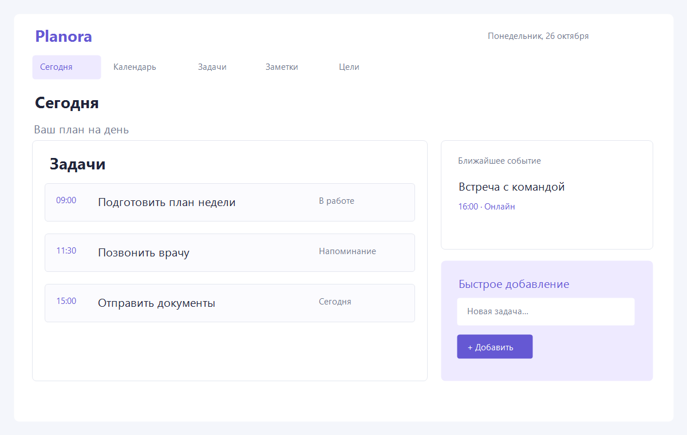
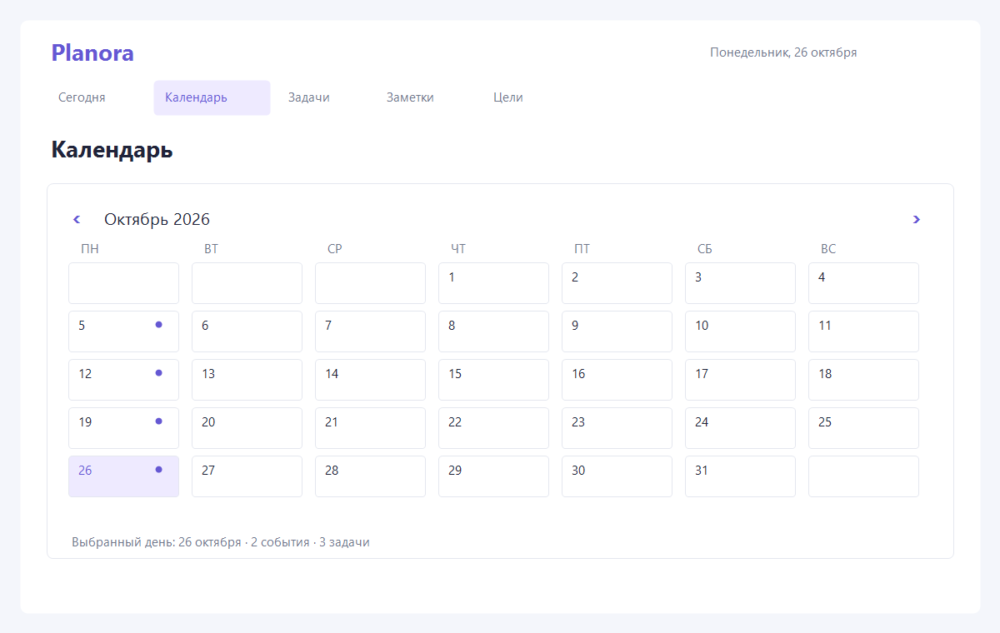
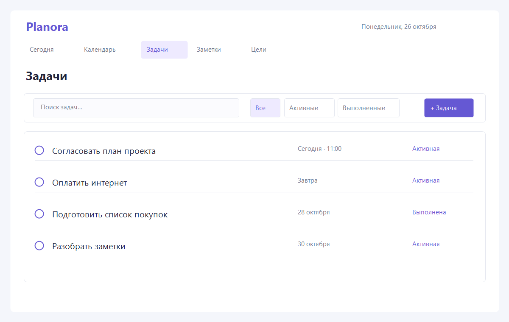
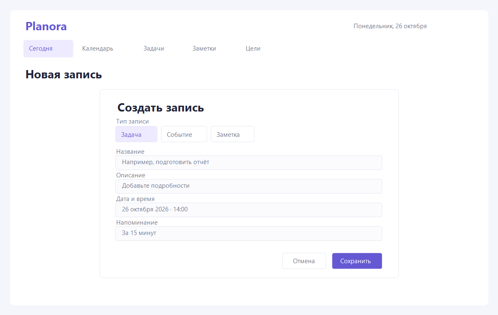

# ОТЧЕТ ПО ЛАБОРАТОРНОЙ РАБОТЕ № 3

**Дисциплина:** «Жизненный цикл разработки программного обеспечения»
**Тема:** «Разработка и документирование бизнес-требований»
**Проект:** Planora — персональный веб-планер
**Студент:** С. А. Колковская
**Город и год:** Минск, 2026

> Перед сдачей перенесите титульный лист и оформление в требуемый кафедрой шаблон СТП БГУИР, уточните ФИО преподавателя, номер группы и проверьте нумерацию иллюстраций.

## 1 ЦЕЛЬ РАБОТЫ

- изучить процесс выявления требований;
- научиться документировать требования;
- получить навыки совместной работы с требованиями.

## 2 ЗАДАЧИ

1. Изучить теоретические сведения по выявлению и документированию требований.
2. Ответить на контрольные вопросы.
3. Выбрать вариант приложения и определить тип проекта.
4. Подготовить спецификацию требований и графические материалы.
5. Подготовить документы к рассмотрению заказчиком и преподавателем.

## 3 ОПИСАНИЕ ЗАДАНИЯ

В работе рассматривается сбор бизнес-требований в ходе обсуждения между заказчиком и менеджером проекта. Требования документируются в SRS на основе шаблона репозитория курса. Для графической части необходимо подготовить интерфейсные модели на SysML v2 и сохранить их в PNG. Изменения следует вести в отдельной ветке, согласовывать посредством Pull Request и обновлять по конструктивным замечаниям.

## 4 ЭТАПЫ РАБОТЫ

### 4.1 Выбор темы и определение типа проекта

Выбран вариант 4 — список дел, расписание и напоминания с дополнительной ценностью единого персонального пространства. Название проекта — Planora. Это адаптивное веб-приложение для индивидуального планирования задач, событий, заметок и целей. Предполагаемый стек: React для клиентской части, Java/Spring Boot для серверной части и PostgreSQL для хранения. Язык интерфейса и документации — русский. Внешняя синхронизация календаря не входит в первую версию. Тема и бизнес-требования подлежат подтверждению преподавателем и заказчиком.

### 4.2 Подготовка рабочей ветки

Для изоляции изменений создана отдельная ветка `lab3_requirements`. После окончательной проверки подготовленные файлы будут зафиксированы отдельным коммитом. Pull Request предназначен для получения замечаний напарника и преподавателя.

### 4.3 Документирование требований в SRS

Подготовлена спецификация [`srs/planora-srs.md`](../srs/planora-srs.md) на русском языке. В ней описаны область применения и бизнес-цели, ограничения, пользователи, допущения и зависимости, интерфейсы и функции, качественные требования и способы верификации.

Требования имеют идентификаторы `REQ-[AREA]-[NNN]`, например `REQ-FUNC-001` и `REQ-SEC-001`. Формулировки задают обязательное поведение через слово «должна». В матрице верификации для требований указаны метод проверки и сценарий/артефакт. Неизвестные детали отмечены как вопросы для согласования; требования к внешним календарям, повторяющимся событиям, срокам хранения данных и восстановлению доступа требуют подтверждения заказчика.

### 4.4 Разработка структурных моделей интерфейса

Подготовлены четыре исходные модели экранов в синтаксисе SysML v2 `part def`:

- экран «Сегодня»;
- календарь;
- список задач;
- форма создания записи.

Исходники хранятся в `srs/images/`. Для представления компоновки подготовлены PNG-мокапы. Перед сдачей рекомендуется открыть исходники в SysML v2 Studio, проверить совместимость с используемой версией редактора и при необходимости повторно экспортировать диаграммы из него.

Рисунок 4.1 — Экран «Сегодня»

Рисунок 4.2 — Календарь

Рисунок 4.3 — Список задач

Рисунок 4.4 — Форма создания записи

### 4.5 Обновление SRS и подготовка изображений

В приложении SRS добавлены относительные ссылки на PNG и исходные модели. История изменений документа содержит версии 0.1 и 0.2. PNG-мокапы предназначены для обсуждения требований и являются низкодетализированными прототипами.

## 5 КОНТРОЛЬНЫЕ ВОПРОСЫ

**1. Какие ресурсы ограничены и волнуют заказчика, заказывающего разработку ПО?**
Обычно это время, бюджет и трудовые ресурсы. Также заказчика волнуют качество, объём возможностей, риски, соответствие законодательным и организационным ограничениям и стоимость дальнейшего сопровождения. Изменение одного ограничения часто влияет на остальные.

**2. Хорошо ли, когда заказчик видит только один раз разработанное ПО, когда оно готово? Почему?**
Нет. При позднем показе ошибки понимания требований обнаруживаются после того, как решения уже реализованы, и исправление обходится дороже. Регулярные демонстрации прототипов и промежуточных версий дают заказчику возможность рано проверить направление работы.

**3. Стоит ли обращаться к заказчику на протяжении этапа сбора требований и разработки, если какие-либо из них не ясны? Что это даст?**
Да. Уточнения помогают снять неоднозначность до реализации, выявить скрытые сценарии и согласовать приоритеты. Это снижает риск неверной реализации, переделок и расхождения ожиданий.

**4. Что такое требование к ПО?**
Требование к ПО — документированное условие, свойство или функция, которой должна соответствовать система для удовлетворения потребности пользователя, заказчика или другого заинтересованного лица. Хорошее требование необходимо, однозначно, проверяемо и согласовано.

**5. Как правило, обладает ли заказчик в начале разработки ясным видением того, что должно получиться в итоге? Что сделать для того, чтобы уменьшить затраты заказчика?**
Часто видение неполное и уточняется по мере знакомства с возможностями продукта. Затраты уменьшают интервью и совместные обсуждения, приоритизация, ранние макеты и прототипы, частые демонстрации и проверка требований до реализации.

**6. Как правило, меняются ли требования во время разработки проекта? Как организовать работу с заказчиком так, чтобы свести затраты на переделывание ПО к минимуму?**
Да, требования обычно меняются при появлении новой информации или изменении условий. Следует фиксировать версии требований, оценивать влияние изменений, согласовывать приоритеты, сохранять трассировку и регулярно показывать инкременты заказчику. Конструктивные замечания учитываются в новой версии; отклонения обосновываются и документируются.

## ЗАКЛЮЧЕНИЕ

Подготовлена спецификация требований к Planora и четыре экранные модели с PNG-мокапами. Сформулированы бизнес-цели, пользовательские роли, функциональные и качественные требования, а также способы их проверки. Подготовлены ответы на контрольные вопросы и отчётная структура. Совместное рассмотрение с напарником и преподавателем, создание ветки, коммит и Pull Request остаются следующими организационными этапами; их результаты должны быть внесены после фактического проведения.
