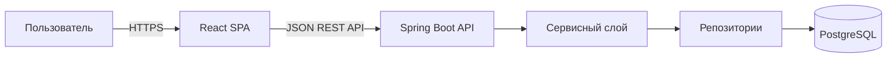

# Описание дизайна программного обеспечения (SDD)

## Planora — персональный веб-планер

Версия 1.0 · 8 ноября 2026 г.  
Автор: С. А. Колковская · Учебный проект

## История изменений

| Версия | Дата | Причина |
|---|---|---|
| 1.0 | 08.11.2026 | Архитектура первой версии и трассировка к SRS 0.3 |

## 1. Введение

### 1.1 Назначение документа

Документ описывает проектное решение Planora и служит руководством для реализации и сопровождения первой версии. Он предназначен разработчикам, архитектору, тестировщику и оператору. Требования берутся из [SRS](../srs/planora-srs.md); архитектурные основания зафиксированы в [ADR](../adr/).

### 1.2 Область применения

Planora — персональный адаптивный веб-планер: аутентификация, задачи, календарные события, заметки, цели, поиск, настройки, напоминания внутри приложения и резервный экспорт/импорт CSV. Дизайн покрывает веб-клиент React, API Java/Spring Boot и PostgreSQL. Командная работа, внешняя синхронизация календаря, мобильные приложения и доставка напоминаний при закрытом приложении исключены из первой версии.

### 1.3 Определения и сокращения

| Термин | Значение |
|---|---|
| API | Интерфейс взаимодействия клиентской и серверной частей |
| CRUD | Создание, чтение, изменение и удаление записи |
| DTO | Объект передачи данных через API |
| SRS / SDD / ADR | Требования / описание дизайна / запись архитектурного решения |

### 1.4 Ссылки

- [SRS Planora, версия 0.3](../srs/planora-srs.md)
- [ADR-0001: модульный монолит и слоистая архитектура](../adr/ADR-0001-modular-monolith.md)
- [ADR-0002: сессии и владение данными](../adr/ADR-0002-auth-and-data-isolation.md)
- [План и переписка с заказчиком](../docs/lab4-plan.md)

### 1.5 Обзор

Раздел 2 описывает заинтересованные стороны и выбранные точки зрения. Раздел 3 задаёт компоненты, интерфейсы, модель данных и последовательности. Раздел 4 связывает решения с ADR.

## 2. Обзор дизайна

### 2.1 Задачи стейкхолдеров

| Стейкхолдер | Задача | Дизайн-ответ |
|---|---|---|
| Пользователь | Вести личные планы с телефона и компьютера | Адаптивный UI, разделение по типам записей |
| Заказчик | Получить полезный релиз к фиксированному сроку и бюджету | Приоритизация, итерации, CSV-обмен как согласованное расширение |
| Разработчик | Реализовать функции без потери данных | Слои API/сервис/репозиторий, транзакции, трассировка |
| Оператор | Развернуть и диагностировать приложение | Конфигурация окружения, миграции, безопасные журналы |

### 2.2 Выбранные точки зрения

Используются контекст, композиция, интерфейс, взаимодействие, информация и развёртывание: они отвечают главным вопросам реализации небольшого веб-продукта. Другие точки зрения раскрыты в соответствующих проектных представлениях ниже.

## 3. Проектные представления

### DV-01 — Контекст и композиция

**Viewpoint:** Context / Composition. **SRS:** REQ-INT-001, REQ-INT-005—007, REQ-IMPL-001—003.

React отвечает за навигацию, формы, календарное представление и сообщения о состоянии. Spring Boot выполняет проверку входных данных, аутентификацию, бизнес-правила, проверку владельца и транзакции. PostgreSQL хранит аккаунты и принадлежащие им записи. Это модульный монолит; сетевой вызов между клиентом и сервером — единственная граница процессов.

### DV-02 — Логическая структура и зависимости

**Viewpoint:** Structure / Dependency. **Решение:** ADR-0001. **SRS:** REQ-FUNC-001—020, REQ-SEC-001—005.

Серверные модули: `auth`, `tasks`, `events`, `notes`, `goals`, `search`, `reminders`, `settings`, `data-transfer`. Каждый модуль использует общие компоненты `api`, `security`, `persistence` и `observability`. Направление зависимостей: контроллер → прикладной сервис → доменная модель/порт репозитория → адаптер PostgreSQL. Контроллер не обращается к БД напрямую. В клиенте разделены `pages`, `components`, `api`, `state` и `types`.

### DV-03 — Интерфейсы

**Viewpoint:** Interface. **SRS:** REQ-INT-001—006, REQ-FUNC-001—020.

Клиент вызывает версионированный JSON API под `/api/v1`. Ресурсы задач, событий, заметок и целей поддерживают операции по владельцу; пагинация применяется к спискам и поиску. Ошибки возвращаются в едином формате `{code, message, correlationId, fieldErrors}`. Даты и время передаются в ISO 8601; сервер хранит моменты времени в UTC, календарные даты отдельно от временных интервалов.

Экспорт: `GET /api/v1/data/export?format=csv`, только текущего пользователя, заголовок UTF-8. Импорт: `POST /api/v1/data/import/preview`, затем подтверждение токеном предпросмотра. Импорт выполняется атомарно в транзакции; неверная структура отклоняется до записи данных. CSV содержит тип записи и стабильный внешний идентификатор; формулы в ячейках экранируются при экспорте.

### DV-04 — Информация и изоляция данных

**Viewpoint:** Information. **SRS:** REQ-FUNC-002—020, REQ-SEC-001—004, REQ-REL-001—002.

Сущности: `User(id, email, password_hash, timezone, calendar_view)`, `Task`, `Event`, `Note`, `Goal`, `Reminder`. Все пользовательские записи содержат `owner_id` с внешним ключом на `User`; уникальные идентификаторы генерируются сервером. Удаление аккаунта и политика хранения требуют отдельного согласования. Миграции схемы версионируются и выполняются перед запуском приложения.

**Правило безопасности:** идентификатор владельца берётся из аутентифицированного контекста, а не из тела запроса. Запрос чтения/изменения/удаления всегда ограничивается `owner_id`; отсутствие чужой записи отвечает одинаковым `404`, чтобы не раскрывать её существование. Пароль хранится только в стойком хеше; секреты задаются конфигурацией окружения.

### DV-05 — Взаимодействие и состояния

**Viewpoint:** Interaction / State Dynamics. **SRS:** REQ-FUNC-003—018, REQ-REL-001—002, REQ-AVAIL-001.

Для сохранения клиент показывает `loading`, отправляет запрос и показывает `success` только после подтверждения сервера. Ошибка сети или валидации сохраняет введённые данные в форме, показывает понятное сообщение и не имитирует успешную запись. Напоминания внутри приложения выбираются серверным запросом при загрузке пользовательского пространства; интерфейс отображает их при наступлении времени, пока пользователь вошёл в систему.

### DV-06 — Развёртывание и эксплуатация

**Viewpoint:** Deployment / Resources. **SRS:** REQ-INT-005—006, REQ-OBS-001, REQ-IMPL-003.

В среде разработки запускаются React dev server, Spring Boot и PostgreSQL. В целевой среде HTTPS завершается на обратном прокси, который направляет `/api` серверу и статические файлы клиенту. Пароли и ключи не включаются в репозиторий. Сервер пишет структурированные ошибки с `correlationId`, без паролей и содержимого заметок. Резервное копирование, RPO/RTO и production hosting остаются открытыми вопросами SRS.

## 4. Решения

| ID | Решение | Документ |
|---|---|---|
| D-01 | Модульный монолит с разделением на UI/API/сервис/репозитории | [ADR-0001](../adr/ADR-0001-modular-monolith.md) |
| D-02 | Серверная сессия и обязательная фильтрация данных по владельцу | [ADR-0002](../adr/ADR-0002-auth-and-data-isolation.md) |

## 5. Приложения

Матрица требований, оценки, риски, план итераций и согласование объёма находятся в [docs/lab4-plan.md](../docs/lab4-plan.md). Реализация приложения ещё не является предметом этих проектных артефактов; проверка требований запланирована в SRS.
